<div align="center">

<!-- ═════════════ HERO ═════════════ -->


<a href="https://git.io/typing-svg"></a>

<br/>


<br/><br/>

<a href="mailto:shezanmohd1411@gmail.com"></a>
<a href="https://www.linkedin.com/in/YOUR_LINKEDIN"></a>
<a href="https://github.com/shezanmohd"></a>


</div>

<br/>

<!-- ═════════════ ABOUT ═════════════ -->
<div align="center">

<br/>

</div>

```python
class Shezan:
    name        = "Mohd Shezan"
    education   = "B.Tech, Electronics & Communication — NIT Raipur (CGPA 9.31)"
    roles       = ["Full-Stack Developer", "Data Analyst"]
    builds      = ["AI-powered SaaS", "Q&A platforms", "analytics pipelines"]
    loves       = ["clean UI", "scalable backends", "dashboards that tell a story"]
    superpower  = "turning ideas and messy data into polished products"
```

<table>
<tr>
<td width="33%" valign="top">

### 🧑‍💻 Who am I
An electronics engineering student who fell for software. Strong on **DSA, OOP, DBMS & OS**, and I love shipping things people can actually use.

</td>
<td width="33%" valign="top">

### 🛠️ What I do
I build **full-stack web apps** (Next.js · React · Node), **AI-powered SaaS**, and **end-to-end analytics pipelines** (Python · SQL · Snowflake · Power BI).

</td>
<td width="33%" valign="top">

### 🎯 What drives me
Good design + solid engineering. I lead clubs, design for events, and compete in national case challenges — so I code *and* communicate.

</td>
</tr>
</table>

<br/>

<!-- ═════════════ MARQUEE ═════════════ -->
<div align="center">

</div>

<br/>

<!-- ═════════════ SKILLS ═════════════ -->
<div align="center">

</div>

#### 🧠 Languages
 

#### 🌐 Frontend
<br/>
  

#### ⚙️ Backend & Databases
<br/>
    

#### ☁️ Cloud & AI Services
    

#### 📊 Data & BI
       

#### 🧰 Tools


<br/>

<!-- ═════════════ FULL-STACK PROJECTS ═════════════ -->
<div align="center">

</div>

<table>
<tr>
<td width="33%" valign="top">

### 🧩 [DevExchange](https://github.com/shezanmohd/DevExchange)


Developer Q&A platform with secure auth, questions & answers, voting, comments, profiles and media uploads — on a Backend-as-a-Service architecture.

<br/>
  

</td>
<td width="33%" valign="top">

### 🎬 [VisionFlow](https://github.com/shezanmohd/VisionFlow)


AI media-management SaaS: background removal, context-aware cropping, video compression, asset management and personalised dashboards.

<br/>
  

</td>
<td width="33%" valign="top">

### 📄 [DocuReach](https://github.com/shezanmohd/DocuReach)


AI document processing for identity verification: AWS Textract OCR, fuzzy name matching, role-based access, scan history and email notifications.

<br/>
 

</td>
</tr>
</table>

<br/>

<!-- ═════════════ DATA PROJECTS ═════════════ -->
<div align="center">

<br/>

</div>

<table>
<tr>
<td width="33%" valign="top">

### 📱 [Mobile Sales Dashboard](https://github.com/shezanmohd/Mobile-Sales-Dashboard)


KPI cards, slicers & drill-downs across brands, models and payment methods, with **MTD** and **Same-Period-Last-Year** comparisons.

  

</td>
<td width="33%" valign="top">

### 🌾 [Agriculture Data Analysis](https://github.com/shezanmohd/Agriculture-Data-Analysis)


Raw Karnataka data in **S3** → IAM-secured transfer → **Snowflake** transforms & SQL profiling → Power BI yield dashboard.

  

</td>
<td width="33%" valign="top">

### 🛍️ [Customer Shopping Analytics](https://github.com/shezanmohd/Customer-Shopping-Analytics)


Pandas cleaning pipeline, **10 SQL queries** with window functions & CTEs, and a multi-filter Power BI dashboard on MS SQL Server.

  

</td>
</tr>
</table>

<br/>

<!-- ═════════════ RUNNER DIVIDER ═════════════ -->
<div align="center">

</div>

<br/>

<!-- ═════════════ STATS ═════════════ -->
<div align="center">

<br/>


<br/><br/>

<!-- Animated contribution snake (needs the included GitHub Action to run once) -->
<picture>
  <source media="(prefers-color-scheme: dark)" srcset="https://raw.githubusercontent.com/shezanmohd/shezanmohd/output/github-snake-dark.svg">
  
</picture>

</div>

<br/>

<!-- ═════════════ ACHIEVEMENTS ═════════════ -->
<div align="center">

</div>

<table>
<tr>
<td align="center" width="33%">
<h1>🥇</h1>
<b>Finalist</b><br/>Paper & Poster Presentation<br/><sub>Shaastra, IIT Madras · Biogen vertical</sub>
</td>
<td align="center" width="33%">
<h1>🇮🇳</h1>
<b>Top 100 / 57,000+</b><br/>NationBuilding Case Competition 2024<br/><sub>Central Zone</sub>
</td>
<td align="center" width="33%">
<h1>🌱</h1>
<b>Top 300 in India</b><br/>L'Oréal Sustainability Challenge 2025<br/><sub>People · Planet · Product</sub>
</td>
</tr>
</table>

<table>
<tr>
<td align="center" width="33%">📸 <b>Head Coordinator</b><br/>Click Club<br/><sub>Media coverage for Aura, Pixellane & more</sub></td>
<td align="center" width="33%">⚡ <b>Head Coordinator</b><br/>Electronics Students Collective<br/><sub>Departmental events</sub></td>
<td align="center" width="33%">🎨 <b>Core Mentor</b><br/>Sahyog<br/><sub>Posters, socials & promo design</sub></td>
</tr>
</table>

<br/>

<!-- ═════════════ FOOTER ═════════════ -->
<div align="center">


<br/>

<a href="mailto:shezanmohd1411@gmail.com"></a>
<a href="https://www.linkedin.com/in/YOUR_LINKEDIN"></a>
<a href="https://github.com/shezanmohd"></a>

<br/><br/>


<br/>


</div>
